# Mohit Adventure

A complete 2D platform adventure with **30 levels across six worlds**, made with
**Godot 4.7.2** and **GDScript**. All artwork and audio are generated by code at
runtime, so the project needs no external image, music or sound files.

The game is designed for **Windows desktop**, **Android** and **iOS** in
landscape orientation. The base resolution is 1280×720 and the UI adapts to
wider screens and notches.

| | |
| --- | --- |
| Levels | 30 (6 worlds × 5 levels) |
| Bosses | 6 unique bosses, one per world |
| Story | Intro, world intros, boss intros, victory scenes, final ending |
| Missions | Main objective + optional objective on every level |
| Collectibles | Coins, 30 crystal shards, 6 world crystals |
| Achievements | 16 |
| Save format | `ConfigFile` version 2 in `user://` (old saves migrate) |

---

## 1. How to run it (Windows / desktop)

1. Install **Godot 4.7.2** (the standard version, not the .NET version):
   <https://godotengine.org/download>
2. Open Godot and click **Import**.
3. Select this folder's `project.godot` and click **Import & Edit**.
4. Press **F5** (or the Play button).

No extra assets, plugins or downloads are required.

If Godot asks to import resources the first time, let it finish. The
`.godot/` folder is only an editor cache and can be deleted safely.

---

## 2. Controls

| Action | Keyboard / gamepad | Mobile |
| --- | --- | --- |
| Move left | `A` / `Left Arrow` / left stick | left on-screen button |
| Move right | `D` / `Right Arrow` / left stick | right on-screen button |
| Jump | `Space` / `W` / `Up Arrow` / gamepad A | orange jump button |
| Pause | `Esc` / `P` / gamepad Start | pause button in the top-right HUD |

Touch controls are shown automatically on mobile and can be forced on/off in
**Settings → Touch Controls**.

---

## 3. Story

> Six magical crystals kept the kingdoms in balance.
> One stormy night, the Dark Lord stole them all.
> Now forests freeze, deserts burn and the sky grows dark.
> Only one brave explorer can bring the light back.

Mohit travels through six kingdoms, recovers one crystal from each, and finally
faces the Dark Lord in the Sky Kingdom. Story scenes appear before the
adventure, at the start of every world, before each boss fight and after each
victory. Every story card can be advanced with **CONTINUE** or skipped with
**SKIP**, and gameplay is paused while it is open.

---

## 4. Worlds and levels

The original three forest levels are preserved as levels 1–3 (with their
original layouts and names restored: *Forest Beginning*, *Hidden Coin Valley*,
*Wooden Bridge*). The remaining 27 levels are deterministic, data-driven
layouts so they are identical every run.

| World | Level | Name | What is new |
| --- | --- | --- | --- |
| 1. GREEN FOREST | 1 | Forest Beginning | Original level, basic jumps and slimes |
| | 2 | Hidden Coin Valley | Original level, bees and denser coins |
| | 3 | Wooden Bridge | Original level, moving platforms |
| | 4 | Dangerous Forest | Bolder patrols, breakable ground, shard hunt |
| | 5 | **Forest Guardian** | Boss arena — THE FOREST GUARDIAN |
| 2. ICE KINGDOM | 6 | Frozen Entrance | Ice physics, snowball enemies |
| | 7 | Ice Cave | Icicle drops and cracking platforms |
| | 8 | Snowfall Valley | Slippery ledges, speed power-ups |
| | 9 | Frozen Bridge | Narrow crossings, falling icicles |
| | 10 | **Ice Monster** | Boss arena — THE ICE MONSTER |
| 3. DESERT KINGDOM | 11 | Desert Entrance | Sand friction, scorpions |
| | 12 | Lost Pyramid | Quicksand and hidden treasure |
| | 13 | Sandstorm Run | Wind gusts and rock falls |
| | 14 | Ancient Temple | Quicksand, rockfalls and a shard hunt |
| | 15 | **Desert King** | Boss arena — THE DESERT KING |
| 4. DARK CASTLE | 16 | Haunted Forest | Ghosts and dark corridors |
| | 17 | Ghost Dungeon | Moving spikes, disappearing bridges |
| | 18 | Dark Corridor | Tight platforming, shield power-ups |
| | 19 | Castle Tower | Vertical lifts and fire hazards |
| | 20 | **Shadow Knight** | Boss arena — THE SHADOW KNIGHT |
| 5. LAVA KINGDOM | 21 | Burning Entrance | Lava pools and fire imps |
| | 22 | Lava Bridge | Fireballs and breakable platforms |
| | 23 | Volcano Cave | Lava falls and fireball showers |
| | 24 | Fire Temple | Combined fire hazards |
| | 25 | **Lava Dragon** | Boss arena — THE LAVA DRAGON |
| 6. SKY KINGDOM | 26 | Sky Entrance | Sky bats and long gaps |
| | 27 | Floating Islands | Vertical platform chains |
| | 28 | Cloud Adventure | Wind and disappearing clouds |
| | 29 | Sky Castle | The hardest platforming |
| | 30 | **Dark Lord** | Final boss arena — THE DARK LORD |

Boss levels are arenas: there is no finish flag. The level ends when the boss
is defeated, and defeating a world boss awards that world's crystal and unlocks
the next world. Bosses have a themed health bar, stomp damage, contact damage
and their own projectile patterns.

### Hazards, enemies and power-ups

- **Enemies (7 kinds):** slime, bee, snowball, scorpion, ghost, fire imp, sky bat.
- **Hazards (8 kinds):** lava, quicksand, wind zones, fire, moving spikes,
  falling icicles, falling rocks, fireballs.
- **Power-ups (4 kinds):** shield (absorbs one hit), speed boost, extra life
  and heart heal.
- **Special platforms:** moving platforms, breakable platforms that shatter
  after being stepped on, and disappearing platforms that blink and fade on a
  fixed cycle.
- Hidden **treasure chests** award bonus coins and score.

### Missions, stars and crystals

Every level shows a mission panel with a main objective and an optional one.
Optional objectives are one of: collect a number of coins, defeat a number of
enemies, activate all checkpoints, find the hidden treasure, or find the crystal
shard. Boss levels always ask for the crystal shard.

- Completing the level awards **1 star**.
- Collecting at least **60% of the coins** awards **2 stars**.
- Collecting at least **90%** awards **3 stars**.
- Finishing the optional mission raises the result by one star (maximum 3).

Each level hides one **crystal shard** (30 total). Defeating a world boss awards
a **world crystal** (6 total). All collectible progress, stars and best scores
are saved automatically.

---

## 5. Features

- Smooth acceleration, coyote time, jump buffering and variable jump height.
- Camera that follows the player with screen limits and damage shake.
- Coins with score, particle bursts and floating `+10` popups.
- Seven enemy types with patrol, stomp and damage behaviour.
- Three hearts, three lives, damage knockback and invulnerability blinking.
- Checkpoints that heal the player and move the respawn point.
- Moving, breakable and disappearing platforms.
- Environmental wind, quicksand, ice friction, lava and falling hazards.
- Shield and speed power-ups with visible HUD status.
- Mission HUD, boss health bars, combo toasts and reward popups.
- Level select with all 30 levels grouped by world, showing locks, stars,
  shard state, best score and world progress. Mouse, keyboard and touch work,
  and the list scrolls on small screens.
- Separate **CONTINUE** and **NEW GAME** actions.
- Achievements browser with 16 unlockable achievements.
- Story scenes with skippable pages.
- Star rating (1–3 stars per level) and 90 stars in total.
- Pause menu with resume, restart, settings and main menu.
- Game over screen with retry and main menu.
- Procedural music and a larger set of procedural sound effects (coins, jumps,
  power-ups, shields, shards, treasure, breakable platforms, boss hits, boss
  defeat, hazards, achievements, unlocks and story).
- Reliable autosave in `user://`, with migration of the original save format
  and safe recovery from corrupt or missing files.
- Responsive HUD and large touch controls for phones, tablets and wide screens.

Save data location on Windows:

```
%APPDATA%\Godot\app_userdata\Mohit Adventure\mohit_adventure.cfg
```

Delete that file to reset all progress and settings.

---

## 6. Save data, Continue and New Game

The save file is a Godot `ConfigFile` written to `user://mohit_adventure.cfg`.
Saving is automatic after a level is completed, a game over is recorded, a
setting changes, or an achievement unlocks.

**Format (version 2):**

```ini
[save]
version=2

[progress]
unlocked=0
best_score=0
completed=[false, false, ...]      ; 30 entries
stars=[0, 0, ...]                  ; 30 entries, each 0-3
level_scores=[0, 0, ...]           ; 30 best scores
level_coins=[0, 0, ...]            ; 30 best coin counts
optional=[false, false, ...]       ; 30 optional-mission flags
shards=[false, false, ...]         ; 30 crystal shards
crystals=[false, ...]              ; 6 world crystals
lifetime_coins=0
achievements=["first_steps", ...]
story=["intro", "world_0", ...]

[settings]
music=0.65
sfx=0.85
touch=0
```

**Compatibility and safety:**

- Old saves (no version, or version 0/1) keep their unlocked level, best score
  and settings. Levels below the saved unlock point are marked complete with one
  star, and returning players receive the *First Steps* achievement.
- Every array is resized to 30 (6 for crystals) before use, so short or missing
  arrays never crash the game.
- Out-of-range stars, scores, coin counts and volumes are clamped.
- Unknown achievement IDs and story keys are ignored.
- A corrupt or unreadable file is treated as a fresh start; the game still runs
  and the next save writes a clean file.
- **CONTINUE** jumps to the first incomplete level. **NEW GAME** starts again at
  level 1 while keeping unlocks, stars, shards, crystals and achievements, so
  replaying never destroys collected rewards.

**Achievements (16):** First Steps, Forest Guardian, Ice Breaker, Desert Ruler,
Shadow Bane, Dragon Slayer, Dark Lord Defeated, Crystal Hunter, Crystal Master,
World Savior, Coin Hoarder, Boss Slayer, Perfectionist, Mission Master,
Untouchable, Adventure Complete.

---

## 7. Project structure

```
jumping/
├── project.godot              Godot project settings (main scene, autoloads)
├── icon.svg                   Procedurally drawn game icon
├── README.md
│
├── Scenes/                    Reusable gameplay scenes
│   ├── MainMenu.tscn
│   ├── Player.tscn
│   ├── ForestBackground.tscn
│   ├── Platform.tscn
│   ├── Coin.tscn
│   ├── Enemy.tscn
│   ├── MovingPlatform.tscn
│   ├── BreakablePlatform.tscn
│   ├── DisappearingPlatform.tscn
│   ├── Spikes.tscn
│   ├── Hazard.tscn
│   ├── PowerUp.tscn
│   ├── Treasure.tscn
│   ├── CrystalShard.tscn
│   ├── Boss.tscn
│   ├── BossProjectile.tscn
│   ├── Checkpoint.tscn
│   ├── FinishFlag.tscn
│   ├── Decoration.tscn
│   └── BurstEffect.tscn
│
├── Scripts/
│   ├── Autoload/
│   │   ├── game_manager.gd    Score, lives, progress, save file, navigation
│   │   └── audio_manager.gd   Procedural music and sound effects
│   ├── Player/
│   │   ├── player.gd          Movement, jump, damage, power-ups, environment
│   │   └── player_visual.gd   Procedurally drawn hero
│   ├── Enemies/
│   │   └── enemy.gd           Seven enemy kinds, patrol / stomp / damage
│   ├── Boss/
│   │   ├── boss.gd            Six boss looks and attack patterns
│   │   └── boss_projectile.gd Themed boss projectiles
│   ├── Objects/
│   │   ├── platform.gd        Eight world platform styles
│   │   ├── coin.gd
│   │   ├── moving_platform.gd
│   │   ├── breakable_platform.gd
│   │   ├── disappearing_platform.gd
│   │   ├── spikes.gd
│   │   ├── hazard.gd          Lava, quicksand, wind, fire, icicles, rocks…
│   │   ├── powerup.gd         Shield, speed, extra life, heal
│   │   ├── treasure.gd
│   │   ├── crystal_shard.gd
│   │   ├── checkpoint.gd
│   │   ├── finish_flag.gd
│   │   ├── decoration.gd      Twenty-three procedural decoration kinds
│   │   └── burst_effect.gd
│   ├── Levels/
│   │   ├── level.gd           Builds a level and runs its gameplay flow
│   │   ├── level_data.gd      Outlines, hazards, missions and boss arenas
│   │   └── world_data.gd      World names, palettes, bosses and story text
│   └── UI/
│       ├── main_menu.gd
│       ├── level_select.gd    30-level, six-world scrollable select screen
│       ├── achievements.gd    Achievement browser
│       ├── story_card.gd      Skippable story overlay
│       ├── settings_panel.gd
│       ├── hud.gd             Hearts, score, mission, boss bar, status
│       ├── hearts.gd
│       ├── coin_icon.gd
│       ├── pause_menu.gd
│       ├── level_complete.gd
│       ├── game_over.gd
│       ├── touch_controls.gd
│       ├── touch_button.gd
│       ├── scene_fader.gd
│       └── forest_background.gd
│
├── UI/                        HUD, menus and overlays
│   ├── HUD.tscn
│   ├── LevelSelect.tscn
│   ├── Achievements.tscn
│   ├── StoryCard.tscn
│   ├── SettingsPanel.tscn
│   ├── PauseMenu.tscn
│   ├── LevelComplete.tscn
│   ├── GameOver.tscn
│   ├── TouchControls.tscn
│   ├── Hearts.tscn
│   ├── CoinIcon.tscn
│   └── SceneFader.tscn
│
├── Levels/
│   ├── LevelBase.tscn         Common level scene tree
│   ├── Level1.tscn            … through …
│   └── Level30.tscn
│
├── Assets/Theme/
│   └── mohit_theme.tres       Buttons, panels, labels, fonts
│
├── Tests/                     Development-only automated tests
│   ├── SmokeTest.tscn
│   ├── FlowTest.tscn
│   ├── MobileTest.tscn
│   ├── ExpansionTest.tscn
│   ├── ValidateResources.tscn
│   └── CaptureScreens.tscn
│
└── Screenshots/               Preview images (ignored by Godot)
```

### Data-driven levels

All 30 levels are defined in `Scripts/Levels/level_data.gd`. Levels 1–3 are
the original hand-made layouts. Levels 4–30 are generated deterministically
from per-world seeds, so their platforms, coins, enemies, spikes, hazards,
checkpoints, breakables and decorations are always identical for a given
level. World names, palettes, boss names and story text live in
`Scripts/Levels/world_data.gd`.

To tune a level, edit its data (or the generator) and run the tests. No nodes
need to be placed by hand.

---

## 8. Automated tests

These scenes are for development. Run them from a terminal:

```powershell
$godot = "C:\path\to\Godot_v4.7.2-stable_win64_console.exe"

# Gameplay: movement, jump, coins, enemies, checkpoint, death, finish
& $godot --headless --path "D:\jumping" "res://Tests/SmokeTest.tscn"

# Menus, settings, level select, pause, level complete, game over, transitions
& $godot --headless --path "D:\jumping" "res://Tests/FlowTest.tscn"

# Touch button visibility, layout and input actions
& $godot --headless --path "D:\jumping" "res://Tests/MobileTest.tscn"

# 30-level expansion: data, scenes, bosses, missions, progression,
# achievements, save migration/corruption, UI, story cards, power-ups
& $godot --headless --path "D:\jumping" "res://Tests/ExpansionTest.tscn"

# Loads every scene and script to catch broken paths or parse errors
& $godot --headless --path "D:\jumping" "res://Tests/ValidateResources.tscn"
```

The expansion test backs up and restores the real save file, so running it
never changes player progress.

### Results in this environment (Godot 4.7.2 on Windows)

| Suite | Result |
| --- | --- |
| ExpansionTest | **368 passed, 0 failed** |
| SmokeTest | **39 passed, 0 failed** |
| FlowTest | **22 passed, 0 failed** |
| MobileTest | **14 passed, 0 failed** |
| ValidateResources | **69 scenes, 45 scripts, 0 failures** |

The expansion test loads and builds all 30 level scenes in one run, including
all six boss arenas, and checks every level's coins, enemies, hazards,
power-ups, treasure, shards, breakable platforms and disappearing platforms.
It also verifies the original three forest layouts are still present.

You can regenerate the preview images in `Screenshots/` by running the capture
scene with a real window (not `--headless`):

```powershell
& $godot --path "D:\jumping" "res://Tests/CaptureScreens.tscn"
```

> Godot sometimes prints `ObjectDB instances were leaked at exit` when a test
> forces the process to quit. It is a shutdown warning from the test harness,
> not a gameplay error. The expansion suite reports 6 such leaked instances and
> the smaller suites report 2; this is cosmetic and does not affect the game.

---

## 9. Screenshots

### Menus and progression

| Main menu | Level select (top) | Level select (worlds) |
| --- | --- | --- |
| 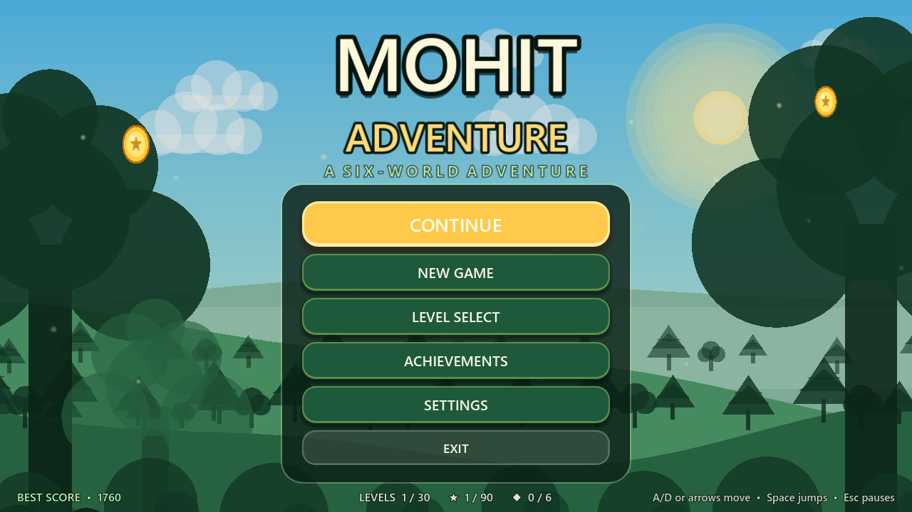 | 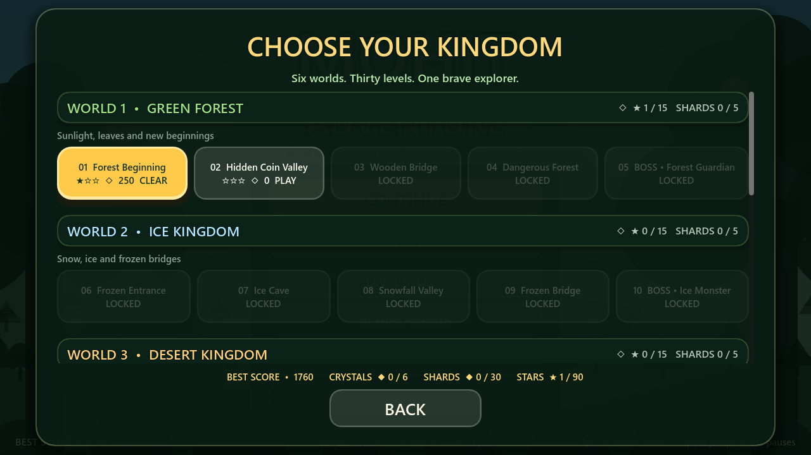 | 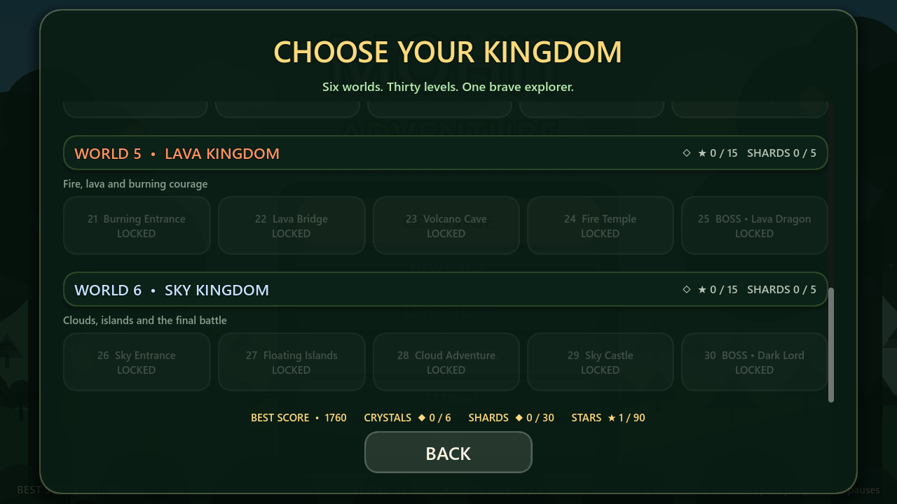 |

| Achievements | Story intro | Level complete |
| --- | --- | --- |
| 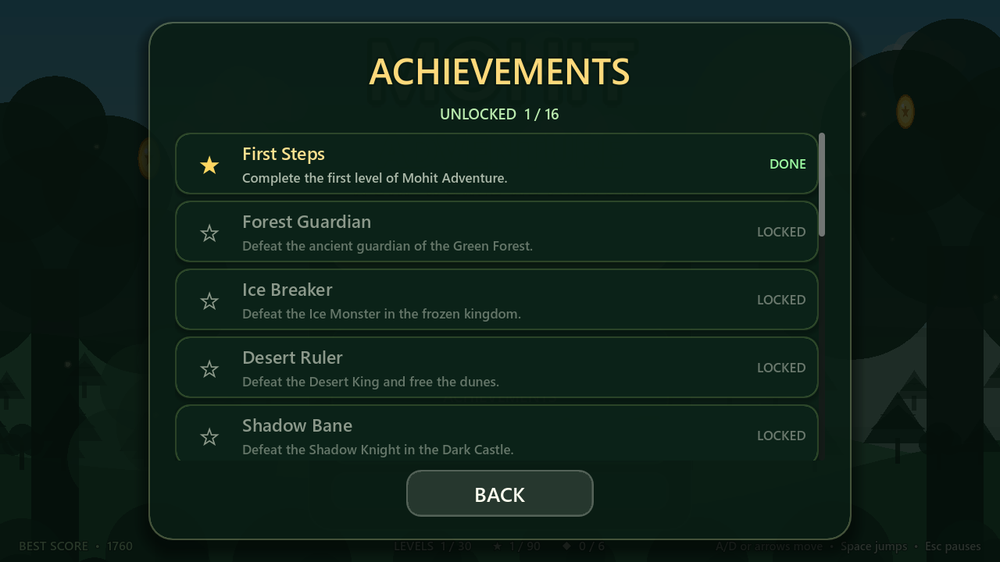 | 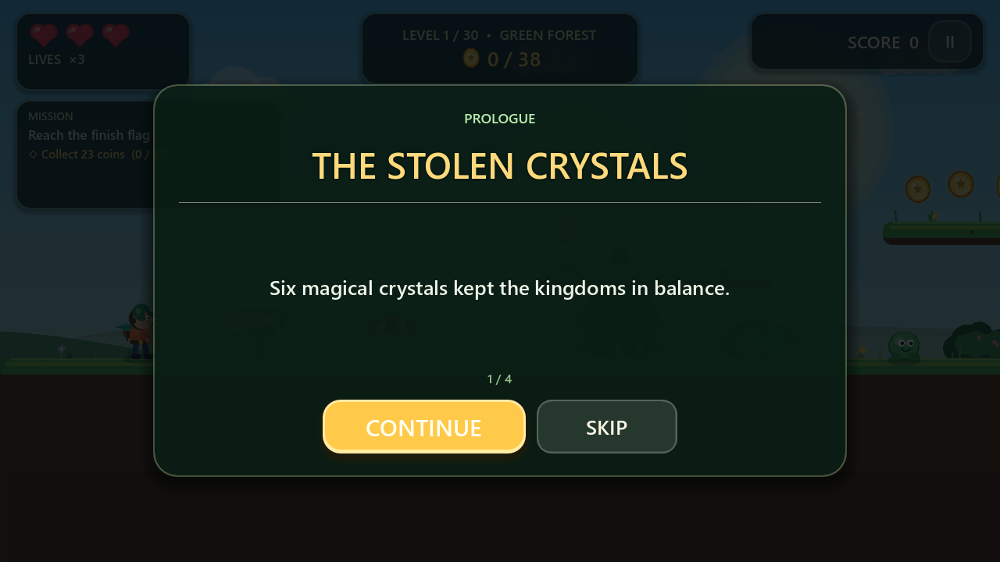 | 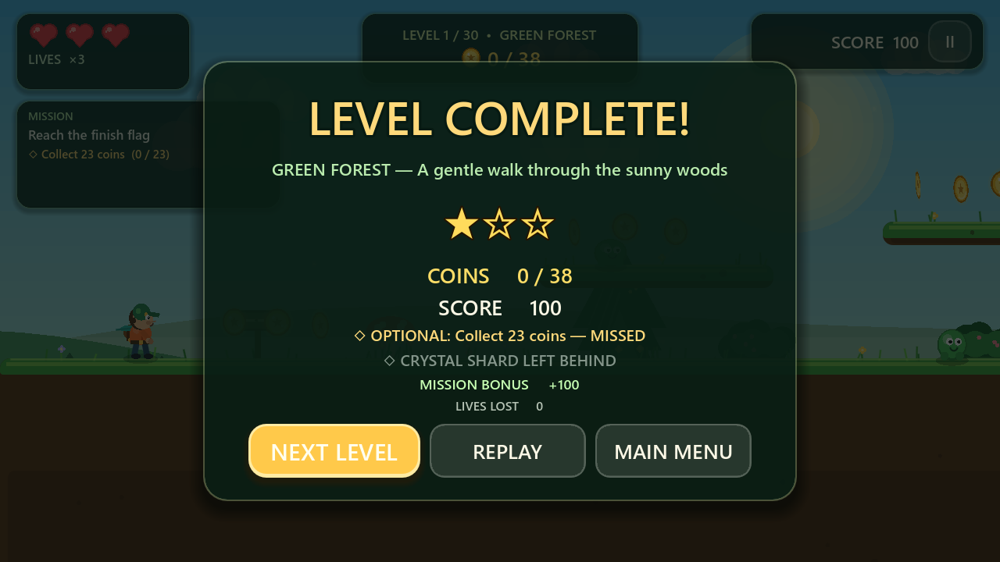 |

### World 1 — Green Forest

| Stage | Boss |
| --- | --- |
| 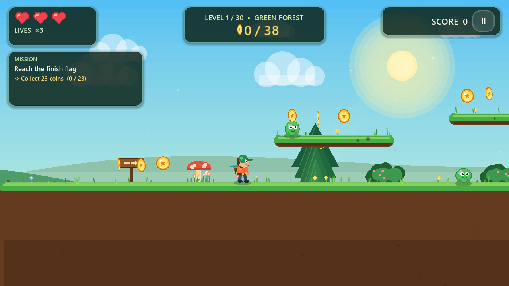 | 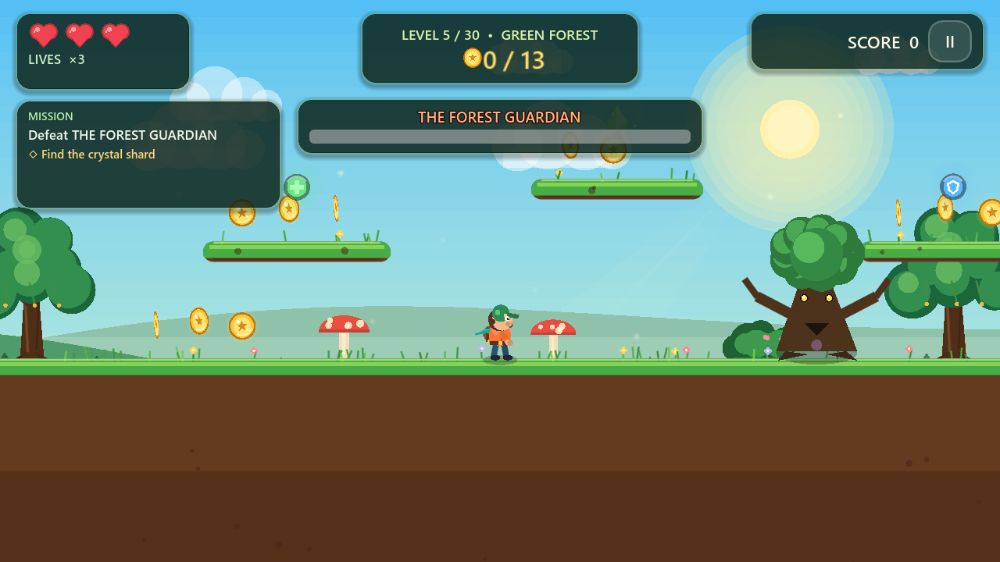 |

### World 2 — Ice Kingdom

| Stage | Boss |
| --- | --- |
| 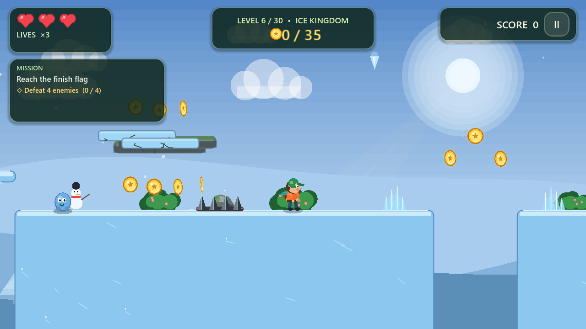 | 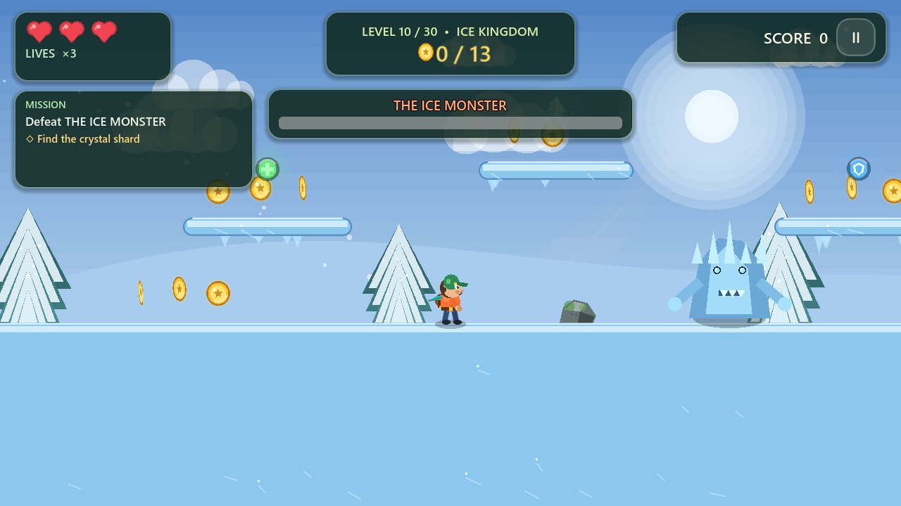 |

### World 3 — Desert Kingdom

| Stage | Boss |
| --- | --- |
| 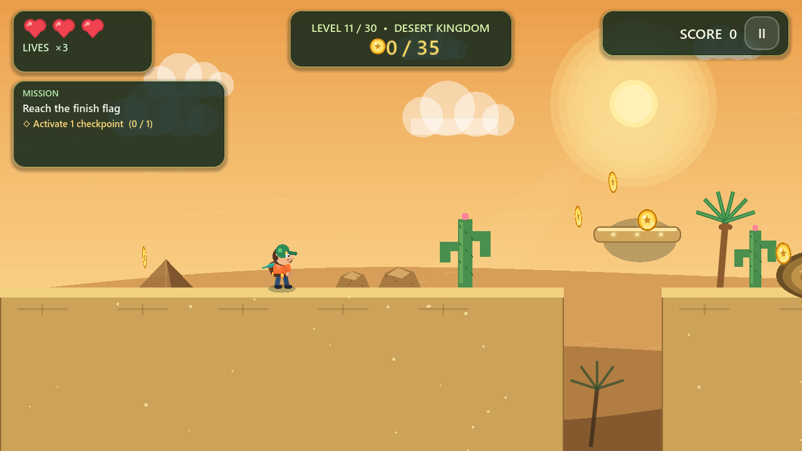 | 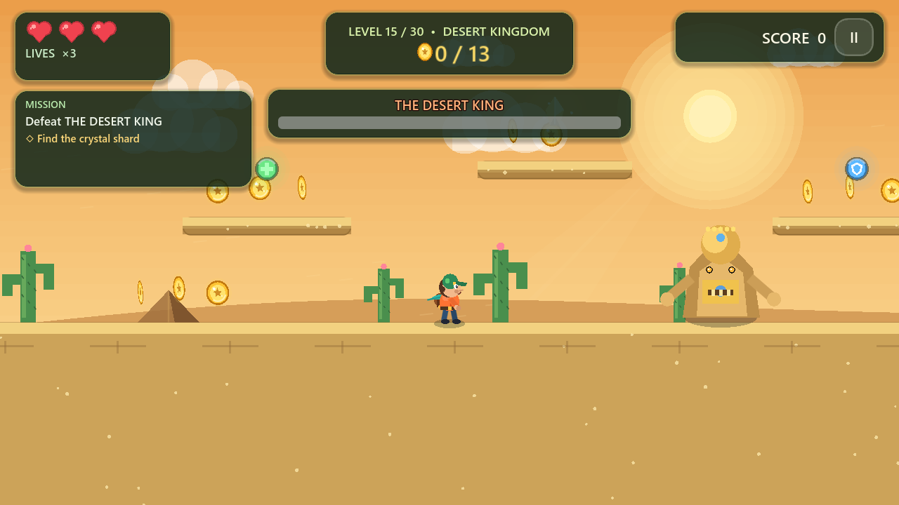 |

### World 4 — Dark Castle

| Stage | Boss |
| --- | --- |
| 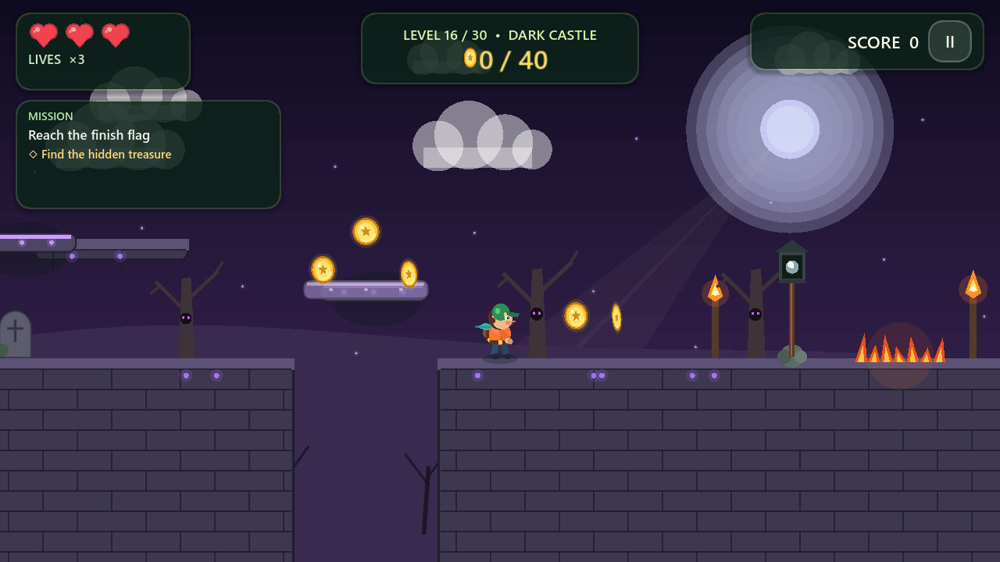 | 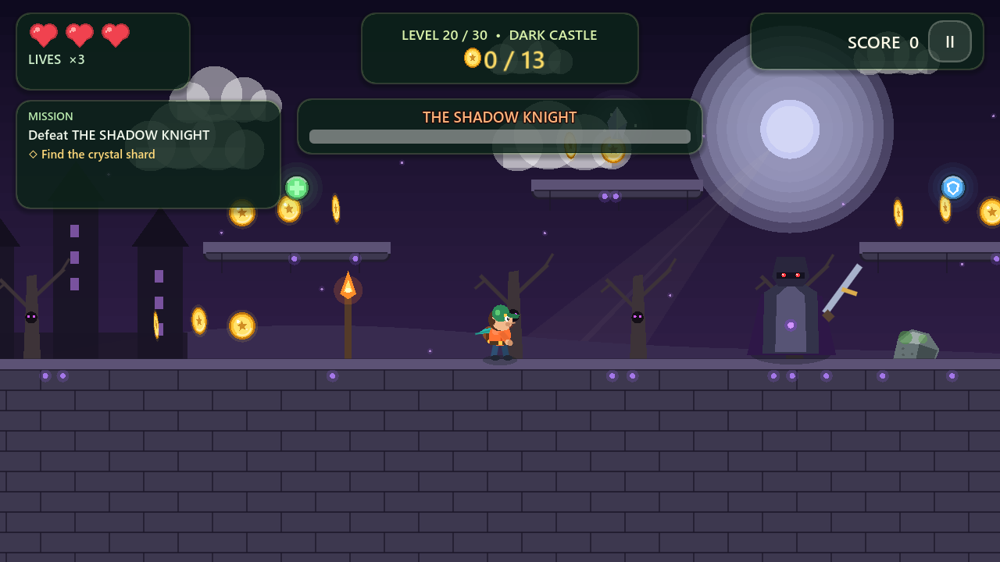 |

### World 5 — Lava Kingdom

| Stage | Boss |
| --- | --- |
| 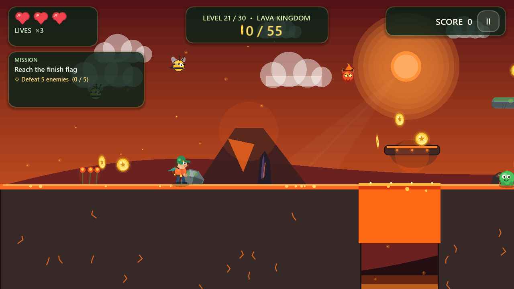 | 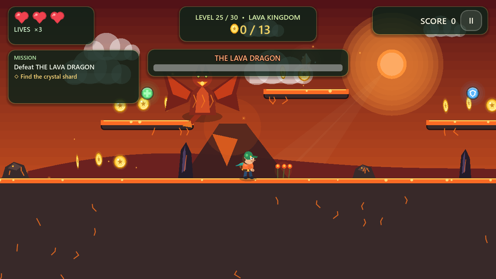 |

### World 6 — Sky Kingdom

| Stage | Boss |
| --- | --- |
| 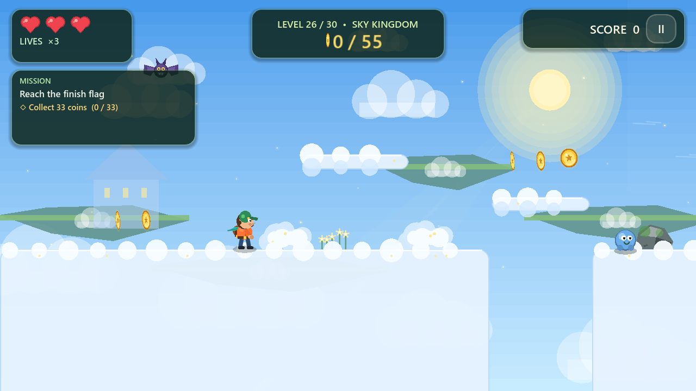 | 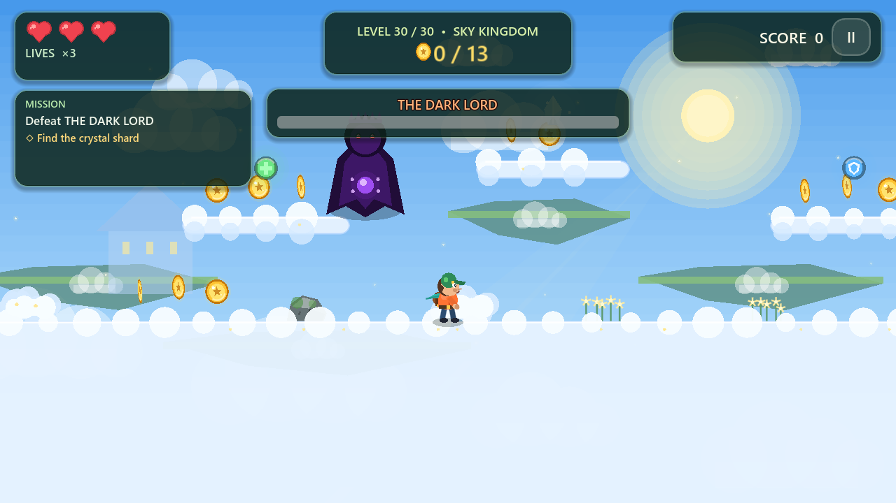 |

Additional captures: `menu_settings.png`, `level1_touch.png`.

---

## 10. Android testing and building an APK

### One-time setup

1. Install **Godot 4.7.2** and open
   **Editor → Manage Export Templates → Download and Install**.
2. Install **Android Studio** with:
   - Android SDK Platform (API 34 or newer)
   - Android SDK Build-Tools
   - Android SDK Platform-Tools (`adb`)
   - OpenJDK 17 (Godot's required JDK)
3. In Godot open **Editor → Editor Settings → Export → Android** and set the
   **Android SDK Path** (for example
   `C:\Users\<you>\AppData\Local\Android\Sdk`).
4. In Godot open **Project → Install Android Build Template** only if you add
   Android plugins later. This project does not require it.

### Create the export preset

1. **Project → Export → Add… → Android**.
2. Set a unique package name, for example
   `com.mohitadventure.game`.
3. Choose a minimum SDK (API 24 or newer is a safe default) and target the
   latest installed SDK.
4. Leave orientation as **Landscape**; it is already set in `project.godot`.
5. For quick testing, use Godot's debug keystore. For a release build, create
   your own keystore and fill in the release credentials.
6. Click **Export Project…**, keep **Export APK** enabled for direct testing,
   and save `MohitAdventure.apk`.

### Install on a phone

1. Enable **Developer options → USB debugging** on the Android device.
2. Connect it by USB and accept the debugging prompt.
3. Run:

```powershell
adb devices
adb install -r "C:\path\to\MohitAdventure.apk"
```

4. Launch **Mohit Adventure** from the phone's app drawer.
5. Check that the touch buttons appear, that the pause button is not under a
   notch, and that the game stays in landscape.

For Google Play, export an **AAB** with a release keystore, increment the
version code for every upload, and complete the store listing and content
rating forms.

### Android requirements summary

- Godot 4.7.2 **export templates** (exact same version).
- Android SDK + Build-Tools + platform-tools + JDK 17.
- A device with Android 7.0 (API 24) or newer for testing.
- Debug keystore for testing; release keystore for publishing.

---

## 11. iOS requirements

iOS builds require **macOS with Xcode**. This cannot be done from Windows.

1. On the Mac, install **Godot 4.7.2** and download the export templates.
2. Install **Xcode** and the command-line tools.
3. Open the project on the Mac, then
   **Project → Export → Add… → iOS**.
4. Set a unique **Bundle Identifier** and your Apple **Team ID**.
5. Export an Xcode project.
6. Open the generated `.xcodeproj` in Xcode, select your signing team and a
   connected device or simulator, then press **Run**.
7. For TestFlight or the App Store you need an **Apple Developer Program**
   membership, app icons, screenshots, privacy answers and a signed archive.

The game already uses the Compatibility renderer and landscape orientation,
which are both suitable for iOS. Touch controls appear automatically on iOS.

---

## 12. Known limitations / not yet tested

- **Windows only was tested in this environment.** The game was run with Godot
  4.7.2 on Windows using the OpenGL Compatibility renderer, and the automated
  tests above were executed.
- **No APK was built or installed here.** Android SDK, a physical Android
  device and Godot's Android export templates were not available in this
  environment.
- **No iOS build was made here.** iOS export requires macOS and Xcode.
- Touch input was verified with simulated button presses. Real-phone testing is
  still recommended for thumb reach, notches and different screen shapes.
- Audio is generated procedurally. It was checked for runtime errors but not
  auditioned on real speakers/headphones.
- The game is English-only and saves progress locally; there is no cloud save.
- The 30 levels were validated by automated scene/data tests and by inspecting
  screenshots of every world, **not by a full human playthrough of all 30
  levels**. Difficulty tuning and secret placement may still need human
  balancing. If a jump feels too hard, adjust the platform positions or jump
  values in `Scripts/Levels/level_data.gd` and `Scripts/Player/player.gd`.
- The expansion suite reports 6 leaked ObjectDB instances at exit (2 in the
  smaller suites). This is a test-harness shutdown warning, not a gameplay bug.

---

## 13. Credits

- Engine: **Godot 4.7.2**.
- Code, procedural artwork, animation, music and sound effects: created for
  this project.
- No paid or third-party assets are included.
